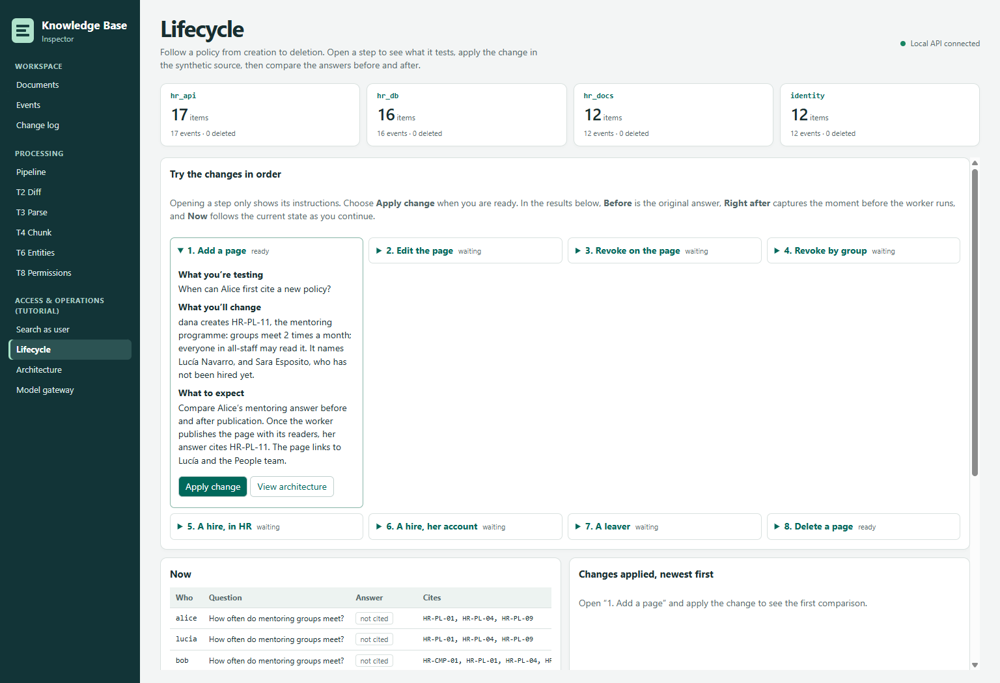
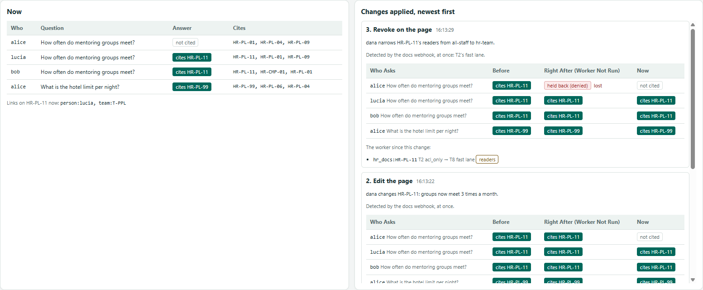
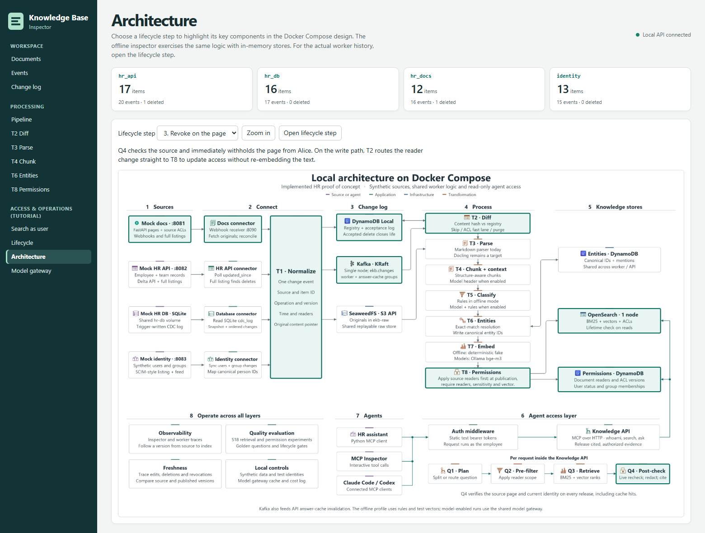
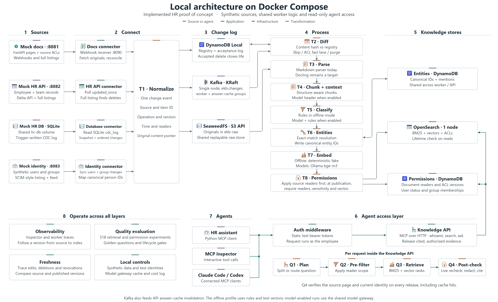
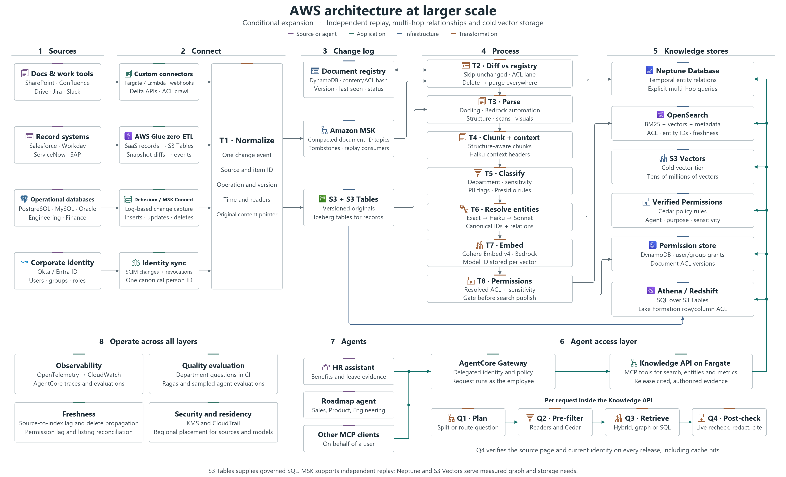

# Enterprise knowledge base for AI agents

[Try the interactive lifecycle walkthrough](https://enterprise-knowledge-lifecycle.mintydandelion3.chatgpt.site) to explore eight recorded cases and their architecture diagrams in your browser. To apply the changes yourself against running synthetic sources, follow the local installation instructions below.

This proof of concept lets an HR assistant answer questions with citations from sources the caller can read. Connectors watch synthetic HR documents, records and identity changes. A worker indexes passages with their access rules. When the assistant asks over MCP (Model Context Protocol), the knowledge API filters candidates by the caller's groups and rechecks access at the source before returning evidence.

Explore the architecture diagrams for the [local Docker Compose stack](#install-docker-and-run-the-service-stack) and the [proposed AWS production deployment](#proposed-aws-production-architecture).

## Install the project

Start here for every setup. The lifecycle demo needs Git, uv and Python 3.13. Add Ollama for real embeddings, Node.js for the inspector, and Docker for the infrastructure or the full service stack. You can run each of those independently after the base install.

1. Install Git. On Windows, run `winget install --id Git.Git -e` in PowerShell. On macOS, run `xcode-select --install` and finish the installer. On Ubuntu or Debian, run `sudo apt update` followed by `sudo apt install git`. [Git installation by platform](https://git-scm.com/install/)
2. Install uv, which manages Python and the project's virtual environment. On Windows, run `winget install --id astral-sh.uv -e`. On macOS or Linux, run `curl -LsSf https://astral.sh/uv/install.sh | sh`. Reopen your terminal so it picks up the new commands. [uv installation guide](https://docs.astral.sh/uv/getting-started/installation/)
3. Verify both tools, clone the project, and install the locked dependencies. The first install needs internet access or a populated package cache.

```sh
git --version
uv --version
git clone https://github.com/juanmigutierrez/enterprise-knowledge-base.git
cd enterprise-knowledge-base
uv python install 3.13
uv sync --locked
uv run python --version
```

The last command should report Python 3.13.x. Run the remaining commands from the repository root unless a step says to change directories.

## Run the lifecycle demo

```sh
uv run ekb demo lifecycle
```

The demo starts the mocks on loopback, uses in-memory stores and issues synthetic user tokens. It runs without Docker, model downloads or API keys.

Follow the mentoring policy through three requests. After an edit, Alice sees the updated meeting frequency once the worker runs. When her access is revoked, her next request loses that citation even before the worker runs. Later, deleting the travel policy removes its citation, including from a previously cached answer. At the end, look for zero restricted-page leaks, zero citations after deletion, and `promises held: 16 of 16`. A broken promise gives the command a nonzero exit status. [Step-by-step demo output](docs/walkthrough/S16-lifecycle.md)

## Install Ollama for local embeddings

1. On **Windows or macOS**, download the installer for your OS, run it, then open the Ollama app. On **Linux**, run `curl -fsSL https://ollama.com/install.sh | sh`. Run `ollama list` to check that the server answers. If it cannot connect, launch the app or run `ollama serve` in a separate terminal and leave it running. [Ollama downloads](https://ollama.com/download) · [Linux service setup](https://docs.ollama.com/linux)
2. Download the project's multilingual embedding model and install the Python integration into the project environment.

```sh
ollama pull bge-m3
ollama list
uv sync --locked --extra ollama
```

3. Create the local configuration file **once**. In PowerShell, run `if (!(Test-Path .env)) { Copy-Item .env.example .env }`. On macOS or Linux, run `test -f .env || cp .env.example .env`. Keep `EKB_PROFILE=local` and `OLLAMA_URL=http://localhost:11434`. The embedding demo needs no provider key.
4. Run the embedding demo and inspect the model ID printed for a chunk.

```sh
uv run --extra ollama --env-file .env ekb demo t7
```

Look for `ollama:bge-m3`, 1,024 dimensions, and the Italian and Spanish translations ranking close to their English equivalent. The demo can fall back to fake vectors if the server is unavailable. If the output says `fake`, check that `ollama list` shows `bge-m3` and that the endpoint in `.env` matches the running server. [Embedding walkthrough](docs/walkthrough/S10-t7-embed.md)

## Configure your own API keys for hosted answers

The offline lifecycle demo and local Ollama embeddings run without API keys. To run the lifecycle demo with model-written answers, finish the Ollama setup above and **create an API key in your own provider account**. One configured provider with model access and available quota is enough to start. Additional keys let the gateway try another provider when one is unavailable.

| Provider | Variable in your local `.env` | Where to create your key |
|---|---|---|
| Google | `GOOGLE_API_KEY` | [Google AI Studio](https://aistudio.google.com/apikey) |
| Groq | `GROQ_API_KEY` | [GroqCloud API keys](https://console.groq.com/keys) |
| Mistral | `MISTRAL_API_KEY` | [Mistral console](https://console.mistral.ai/) |
| OpenRouter | `OPENROUTER_API_KEY` | [OpenRouter API keys](https://openrouter.ai/settings/keys) |

Open the `.env` file you copied from `.env.example` in the repository root. Find your provider's variable and paste your own key immediately after the equals sign. For example, if you chose Groq, replace the placeholder below with the key you created.

```dotenv
GROQ_API_KEY=replace_with_your_own_groq_key
```

Leave unused provider entries empty. Keep real keys only in your local, git-ignored `.env` and leave the tracked `.env.example` blank. Requests use your provider account's quota and billing settings.

```sh
uv run --env-file .env ekb options
uv run --extra ollama --env-file .env ekb demo lifecycle --models
```

The first command shows the configured routes. The second uses Ollama for embeddings and sends synthetic content to the configured chat providers for model-written answers. [Model gateway walkthrough](docs/walkthrough/S07-model-gateway.md)

## Install and open the inspector

Install Node.js 22.12 or newer with npm using the installer for your OS. Open a new terminal and verify `node --version` and `npm --version`. [Node.js downloads](https://nodejs.org/en/download)

In one terminal, start the inspector API with offline models. Its default address is `http://127.0.0.1:8090`.

```sh
uv run ekb inspector --header none --embed fake
```

If you configured provider keys and want to see them in **Model gateway**, start the API with the command below instead. Run it from the repository root and restart the API after editing `.env`. The provider table checks which keys are present in the API process. The flags below use rules for classification, skip generated headers and use fake embeddings.

```sh
uv run --env-file .env ekb inspector --header none --classifier rules --embed fake
```

In a second terminal, starting at the repository root, install the frontend packages and launch the UI.

```sh
cd ui
npm ci
npm run dev
```

Open the address Vite prints, normally [the local inspector](http://127.0.0.1:5173). In Windows PowerShell, you can use `npm.cmd ci` and `npm.cmd run dev` for the two npm commands above.

### Navigate the inspector

Start on **Documents**. Look for **Local API connected** and the four source cards. Filter by `HR-PL` and select a document key to open its event history. On a phone, use the **View** selector in place of the sidebar. If the source cards are missing, check the [local sources endpoint](http://127.0.0.1:8090/api/sources).

### Walk through the eight lifecycle cases

1. Choose **Access & operations (Tutorial) → Lifecycle**. Open **1. Add a page**. You can open any step to read its instructions before changing anything.
2. Read **What you’ll change** and **What to expect**, then choose **Apply change**. This acts on a running synthetic source. Follow the steps in order so each case starts with the people, permissions and policy versions established by the previous cases.



3. Scroll to **Changes applied, newest first**. Read one user’s row from left to right. **Before** and **Right after** capture the answers on either side of the source change, before the worker catches up. **Now** refreshes as the worker processes changes and as you continue the tutorial. For hires and leavers, also inspect **Links on HR-PL-11 now** beneath the current answers.

For example, in step 3 Alice loses the mentoring citation in **Right after**, while Lucía keeps it. Comparing those two rows shows that access changed for one reader even while the same document remained available to another.



| Case | What to look for | Screenshot from the running inspector |
|---|---|---|
| 1. Add a page | After publication, Alice’s mentoring answer cites the new page, `HR-PL-11`. | [New citation](docs/screenshots/lifecycle/add-page.png) |
| 2. Edit the page | The meeting frequency changes from two to three times a month. The page key stays the same. Look at the worker trace for the new version. | [Edit and worker trace](docs/screenshots/lifecycle/edit-page.png) |
| 3. Revoke on the page | Alice loses the citation immediately. Lucía still has access through the HR team. | [Page-level revocation](docs/screenshots/lifecycle/revoke-page.png) |
| 4. Revoke by group | Lucía now loses the same citation after leaving the group. Bob keeps it. | [Group membership change](docs/screenshots/lifecycle/revoke-group.png) |
| 5. A hire, in HR | Sara’s HR record exists. The mentoring page still links only to Lucía and the People team. | [Links before an account exists](docs/screenshots/lifecycle/hire-record.png) |
| 6. A hire, her account | After Sara’s identity arrives, `person:sara` appears among the links on the existing page. | [Sara linked to the page](docs/screenshots/lifecycle/hire-account.png) |
| 7. A leaver | The full HR listing discovers Lucía’s departure. Her link disappears and Sara’s remains. | [Links after departure](docs/screenshots/lifecycle/leaver.png) |
| 8. Delete a page | Alice’s hotel answer drops the deleted `HR-PL-99` and can still cite the current travel policy, `HR-PL-06`. | [Citations after deletion](docs/screenshots/lifecycle/delete-page.png) |

### Follow a case through the architecture

Inside **3. Revoke on the page**, choose **View architecture**. Follow the highlighted **Q4 · Post-check** to see where Alice’s next request checks the source. Then follow **T2 · Diff → T8 · Permissions** to see how the worker updates stored access. The diagram explains the expected route. The worker history in **Lifecycle** shows what ran in your session.



Choose **Zoom in** to inspect a box, **Fit diagram** to see the whole system, or **Open lifecycle step** to return to the selected exercise. You can also use the diagram’s **Lifecycle step** selector to explore another case without applying it.

Use Ctrl+C in both terminals to stop. To inspect real embeddings on a later run, start the API with `uv run --extra ollama --env-file .env ekb inspector --header none --embed model` after completing the Ollama setup above.

## Install Docker and run the service stack

[](docs/architecture/local-compose.png)

1. Install Docker Desktop for Windows or macOS and start it. On Windows, follow the installer's WSL 2 setup and select Linux containers. On Linux, install Docker Engine and the Compose plugin for your distribution, then start the daemon. Verify that `docker info` shows a **Server** section and `docker compose version` prints a version. [Docker Desktop installation](https://docs.docker.com/get-started/get-docker/) · [Compose installation on Linux](https://docs.docker.com/compose/install/linux/)
2. For the infrastructure demo, start Kafka, DynamoDB Local, SeaweedFS and OpenSearch. Wait for the health checks, then run the comparison against the in-memory path.

```sh
docker compose up -d --wait
uv run ekb demo infra
```

3. To run the persistent service processes too, build and start the four mock sources, connector, worker and MCP API. Inspect the running containers and get the synthetic caller tokens from the API log.

```sh
docker compose --profile app up -d --build --wait
docker compose --profile app ps
docker compose logs api
```

4. Replace `ALICE_TOKEN` below with Alice's token from that log. The assistant connects to the local API on port 8080. When finished, stop the stack.

```sh
uv run python -m agents.hr_assistant --token ALICE_TOKEN "How many remote days can I take?"
docker compose --profile app down
```

**Ollama in Docker.** To serve the embedding model from a container, stop any native Ollama server first to free port 11434. Start the model server and pull its weights into the Compose volume.

```sh
docker compose --profile models up -d ollama
docker compose exec ollama ollama pull bge-m3
docker compose exec ollama ollama list
```

For the Python demo on the host, continue with the Python extra, `.env` and T7 command in the Ollama section above. The endpoint is still `http://localhost:11434`.

To also use models **inside the app containers**, configure a chat provider key, set `EKB_MODELS=true` in `.env`, and run the commands below. The worker, connector and API share an image. Build it with the Ollama Python extra alongside its infrastructure drivers. Compose supplies the internal endpoint `http://ollama:11434`. [Service walkthrough](docs/walkthrough/S17d-services.md)

```sh
docker compose --profile app build mock-docs
docker compose --profile app build --build-arg "EXTRAS=--extra kafka --extra search --extra aws --extra ollama" worker
docker compose --profile models --profile app up -d --no-build --wait
docker compose logs worker api
```

When finished with the container model server and app, stop both profiles.

```sh
docker compose --profile models --profile app down
```

## Explore the system

| To investigate | Starting point |
|---|---|
| How a change becomes a searchable passage | [Architecture and data flow](docs/architecture.md) and [walkthroughs in build order](docs/walkthrough/README.md) |
| Which implementations a profile selects | Run `uv run ekb options`. The lifecycle demo prints its active offline choices. |
| How the assistant asks questions | [MCP tools, caller identity and cited answers](docs/walkthrough/S15-mcp-hr-assistant.md) |
| How the same story behaves on Kafka, DynamoDB Local, SeaweedFS and OpenSearch | Start Docker, run `docker compose up -d --wait`, then `uv run ekb demo infra`. [Docker services and teardown](docs/walkthrough/S17d-services.md) |
| How retrieval quality and stale permissions were measured | [Evaluation results and experiment commands](docs/walkthrough/S18-evaluation.md) |
| How the project was built and checked | [AI development and review evidence](docs/ai-sdlc.md) and [clean setup check](docs/walkthrough/S19-clean-setup.md) |

## Assumptions and limits

The sources, people, access groups and policies are synthetic. In the quick start the worker uses offline model substitutes and the assistant quotes evidence. This makes access and deletion checks repeatable. The multilingual retrieval measurements use a separate embedding experiment. The local setup uses demo identities and loopback services. The production design covers AWS infrastructure and authentication separately. [Design decisions](docs/decisions.md)

### Proposed AWS production architecture

Department-owned sources feed a regional pipeline through Amazon MSK. Agents query passages in OpenSearch, relationships in Neptune and metrics through Athena or Redshift. The Knowledge API checks the employee’s access before it returns evidence.

[](docs/architecture/scale-up.png)

## Development checks

```sh
uv run ruff format --check .
uv run ruff check .
uv run mypy
uv run lint-imports
uv run pytest -q --cov
```

The default pytest selection includes the permission, publication and deletion gates. Docker integration tests run separately with `uv run pytest -m integration` after starting the infrastructure. [Repository layout and developer workflow](docs/repo-structure.md)
