# Architecture — production on AWS and the local version

> Matches `decisions.md` as revised on 23 November 2026 (sized for ShopFully / Flipp, ~100–500 employees).
> Editable whiteboard version: https://claude.ai/artifact/YazT11CmDkfHyaCt1ajphY (private until shared; it still shows the earlier large-enterprise sizing — MSK, Neptune from day one, three regions).

**Colours:** yellow = transformation step · blue = AWS managed service · green = our code or open source · grey = source or consumer.
**Flows:** sources → connect → event backbone → process → knowledge stores is the **write path**; agents → access layer → knowledge stores is the **query path**.

---

Chunks become searchable only after T8 attaches their permissions. At query time the index narrows the candidates. Before returning an answer, the API confirms current access to each contributing document through its source connector, including on cache hits. If the source cannot confirm access, the API withholds that evidence.

## 1. Production architecture on AWS

```mermaid
flowchart LR
  subgraph SRC["1 · Sources (owned by departments)"]
    S1["Docs and work tools<br/>SharePoint · Confluence · Drive · Jira · Slack"]
    S2["Record systems<br/>Salesforce · Workday · ServiceNow"]
    S3["Operational databases"]
    S4["Identity providers<br/>Okta / Entra ID via SCIM"]
  end

  subgraph CON["2 · Connect"]
    C1["Custom connectors on Fargate / Lambda<br/>webhooks via EventBridge · delta APIs<br/>ACL crawl · nightly full listing"]
    C2["AWS Glue zero-ETL"]
    C3["AWS DMS change data capture"]
    C4["Identity sync<br/>one canonical person ID"]
    T1[["T1 · Normalize<br/>one change event: source, ID, op, version, ACL, S3 pointer"]]
  end

  subgraph BUS["3 · Event backbone and raw store"]
    Q["EventBridge + SQS FIFO<br/>grouped by document ID<br/>MSK when scale demands it"]
    REG["Document registry<br/>DynamoDB"]
    RAW["S3 versioned originals + S3 Tables<br/>replay source"]
  end

  subgraph PRO["4 · Process (workers)"]
    T2[["T2 · Diff vs registry<br/>skip unchanged · ACL fast lane · delete purges"]]
    T3[["T3 · Parse<br/>Docling · Bedrock Data Automation for scans"]]
    T4[["T4 · Chunk + context header<br/>Claude Haiku 5.5"]]
    T5[["T5 · Classify<br/>Haiku + Presidio rules"]]
    T6[["T6 · Extract + resolve entities<br/>cascade: exact match, Haiku, Sonnet"]]
    T7[["T7 · Embed<br/>Cohere Embed v4, int8"]]
    T8[["T8 · Resolve permissions<br/>user and group IDs + sensitivity"]]
    T2 --> T3 --> T4 --> T5 --> T6 --> T7 --> T8
  end

  subgraph KS["5 · Knowledge stores"]
    OS["Search index · OpenSearch Serverless<br/>BM25 + vectors + ACL + entity IDs<br/>S3 Vectors tier at scale"]
    ENT["Entity store · DynamoDB<br/>Neptune in phase 2"]
    MET["Metrics · Athena / Redshift<br/>Lake Formation row and column security"]
    POL["Policies · Verified Permissions (Cedar)"]
    PERM["Permission store · DynamoDB"]
  end

  subgraph ACC["6 · Agent access layer"]
    GW["AgentCore Gateway<br/>Identity: on behalf of the user<br/>Policy: Cedar, default deny"]
    API["Knowledge API on Fargate<br/>Q1 plan · Q2 pre-filter · Q3 hybrid + rerank<br/>Q4 re-check, redact, cite"]
  end

  AG["7 · AI agents<br/>HR assistant · Roadmap agent · any MCP client"]
  OPS["8 · Operate<br/>CloudWatch · AgentCore Observability and Evaluations<br/>Ragas in CI · freshness monitors · KMS · CloudTrail<br/>EU and Canada deployments"]

  S1 --> C1
  S2 --> C2
  S3 --> C3
  S4 --> C4
  C1 --> T1
  C2 --> T1
  C3 --> T1
  C4 --> T1
  T1 --> Q
  T1 --> RAW
  Q --> T2
  REG <--> T2
  RAW --> T3
  T6 --> ENT
  T8 -->|publish chunk + vector + resolved ACL| OS
  T8 --> PERM
  AG -->|MCP| GW
  GW --> API
  API -->|current access check| C1
  API --> OS
  API --> ENT
  API --> MET
  API --> POL
  API --> PERM

  classDef transform fill:#fff3b0,stroke:#b8a000,color:#000
  classDef aws fill:#d6e9ff,stroke:#3a78c2,color:#000
  classDef own fill:#d9f2d9,stroke:#3a9a3a,color:#000
  classDef ext fill:#eeeeee,stroke:#888888,color:#000
  class T1,T2,T3,T4,T5,T6,T7,T8 transform
  class C2,C3,Q,REG,RAW,OS,ENT,MET,POL,PERM,GW,OPS aws
  class C1,C4,API own
  class S1,S2,S3,S4,AG ext
```

---

## 2. Local version on Docker Compose

The local and production designs share the change-event format, worker logic and Knowledge API contract. Their adapters differ. Local Kafka can replay events. Production workers consume SQS messages and rebuild from versioned S3 originals. The labels in brackets identify the AWS counterparts.

```mermaid
flowchart LR
  subgraph SRC["1 · Sources (mocked, synthetic data)"]
    S1["Mock docs service · FastAPI<br/>pages with ACLs, webhooks on every change<br/>(SharePoint, Confluence)"]
    S2["Mock CRM / HR API<br/>updated_since filter<br/>(Salesforce, Workday)"]
    S3["HR database · Postgres<br/>logical replication on"]
    S4["Keycloak<br/>users, groups, roles, OIDC tokens<br/>(Okta / Entra ID)"]
  end

  subgraph CON["2 · Connect"]
    C1["Connector service<br/>same image: webhooks, delta polling<br/>ACL crawl, nightly full listing"]
    C2["Polling connector<br/>(Glue zero-ETL)"]
    C3["Debezium on Kafka Connect<br/>(DMS change data capture)"]
    C4["Identity sync<br/>Keycloak admin API"]
    T1[["T1 · Normalize<br/>same code as production"]]
  end

  subgraph BUS["3 · Event backbone and raw store"]
    Q["Apache Kafka, KRaft, 1 node<br/>compacted topics, tombstones, replay<br/>same event-bus interface as SQS"]
    REG["Document registry<br/>DynamoDB Local"]
    RAW["SeaweedFS, S3 API<br/>originals + Parquet"]
  end

  subgraph PRO["4 · Process (worker containers, same code)"]
    T2[["T2 · Diff vs registry"]]
    T3[["T3 · Parse<br/>Docling"]]
    T4[["T4 · Chunk + context header<br/>free API tiers via the model gateway"]]
    T5[["T5 · Classify<br/>model + Presidio rules"]]
    T6[["T6 · Extract + resolve entities<br/>same cascade"]]
    T7[["T7 · Embed<br/>bge-m3 via Ollama, or Cohere via Bedrock"]]
    T8[["T8 · Resolve permissions"]]
    T2 --> T3 --> T4 --> T5 --> T6 --> T7 --> T8
  end

  subgraph KS["5 · Knowledge stores"]
    OS["Search index · OpenSearch, 1 node<br/>same mappings and queries"]
    ENT["Entity store · DynamoDB Local<br/>Neo4j Community optional, openCypher only"]
    MET["Metrics · DuckDB over Parquet<br/>(Athena / Redshift)"]
    POL["Policies · Cedar library<br/>same .cedar files as Verified Permissions"]
    PERM["Permission store · DynamoDB Local"]
  end

  subgraph ACC["6 · Agent access layer"]
    GW["Auth middleware<br/>Keycloak tokens, act as the user<br/>same Cedar rules, default deny<br/>(AgentCore Gateway)"]
    API["Knowledge API container<br/>same MCP tools and Q1–Q4 steps<br/>Presidio redaction"]
  end

  AG["7 · Agents and MCP clients<br/>test HR agent · MCP Inspector<br/>Claude Desktop / Code · Codex"]
  OPS["8 · Operate<br/>OpenTelemetry Collector → Jaeger, Prometheus + Grafana<br/>Ragas via pytest · freshness checks · synthetic data only"]

  S1 --> C1
  S2 --> C2
  S3 --> C3
  S4 --> C4
  C1 --> T1
  C2 --> T1
  C3 --> T1
  C4 --> T1
  T1 --> Q
  T1 --> RAW
  Q --> T2
  REG <--> T2
  RAW --> T3
  T6 --> ENT
  T8 -->|publish chunk + vector + resolved ACL| OS
  T8 --> PERM
  AG -->|MCP| GW
  GW --> API
  API -->|current access check| C1
  API --> OS
  API --> ENT
  API --> MET
  API --> POL
  API --> PERM

  classDef transform fill:#fff3b0,stroke:#b8a000,color:#000
  classDef own fill:#d9f2d9,stroke:#3a9a3a,color:#000
  classDef ext fill:#eeeeee,stroke:#888888,color:#000
  class T1,T2,T3,T4,T5,T6,T7,T8 transform
  class C1,C2,C3,C4,Q,REG,RAW,OS,ENT,MET,POL,PERM,GW,API,OPS own
  class S1,S2,S3,S4,AG ext
```

**POC core** (fits the 4–6 hour budget): mock sources, Kafka, workers, OpenSearch, DynamoDB Local, Knowledge API. Keycloak, Neo4j, DuckDB, Presidio, Jaeger and Prometheus / Grafana are optional add-ons.

---

## 3. Transformations at a glance

| Step | Input → output | Production | Local |
|---|---|---|---|
| T1 Normalize | Source-specific change → one change event | Connectors | Same code |
| T2 Diff | Event → skip / process / purge / ACL fast lane | Workers + DynamoDB | Same code + DynamoDB Local |
| T3 Parse | File → clean text with structure | Docling, Bedrock Data Automation | Docling |
| T4 Chunk + context | Text → chunks with a context header | Claude Haiku 5.5 | Free API tiers via the model gateway (S7) |
| T5 Classify | Chunk → department, sensitivity, PII flags | Haiku + Presidio | Model + Presidio |
| T6 Entities | Chunk → canonical entity IDs | Exact match → Haiku → Sonnet | Same cascade |
| T7 Embed | Chunk → vector (model ID stored) | Cohere Embed v4 | bge-m3 or Bedrock |
| T8 Permissions | Source ACL → user and group IDs + label | Workers | Same code |
| Q1–Q4 | Question → filtered, reranked, cited answer context | Knowledge API + Gateway | Same API + middleware |
